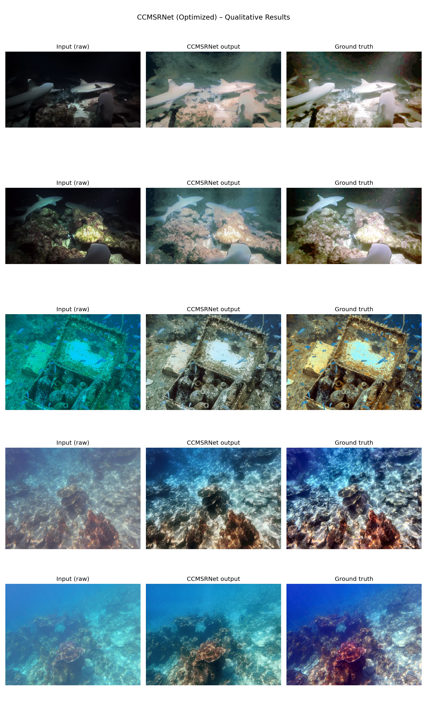
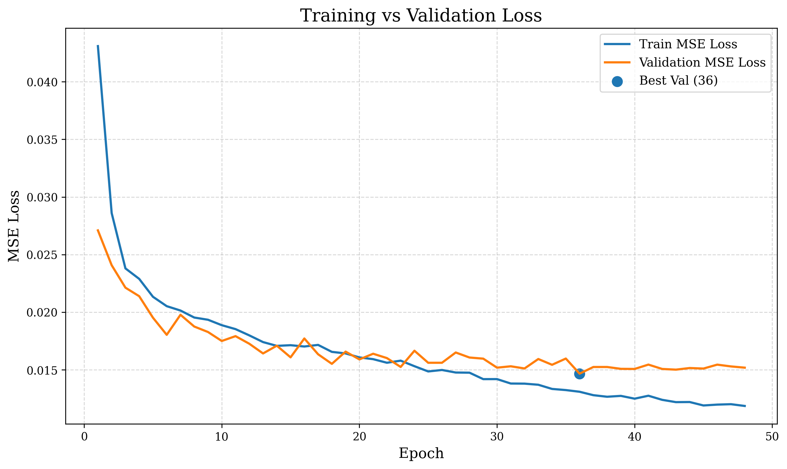

# CILA-SegNet: Underwater Image Enhancement

**CILA-SegNet (Color Casting and Illumination Segregation Network)** is a deep learning-based framework designed to enhance underwater images affected by color casting, uneven illumination, low contrast, and reduced visibility.

The framework builds upon Multi-Scale Retinex with Color Correction (MSRCC-Net) and introduces a channel-segregation approach to handle illumination and color distortions through dedicated processing branches.

## 📄 Research Paper

**Title:** Towards Effective Noise Removal and Visual Enhancement Using CILA-SegNet for Color Casting and Illumination Distortions in Underwater Images

**Authors:** Ishmal Nayab, Muhammad Umair, Maham Mehr, Rao Ayan Shihab, Hira Haider, and Hifza Nadeem

**Publication:** Journal of Independent Studies and Research Computing (JISR-C), Volume 24, Issue 1, 2026

**DOI:** [10.31645/JISRC.26.24.1.10](https://doi.org/10.31645/JISRC.26.24.1.10)

**Paper Link:** https://jisrc.szabist.edu.pk/ojs/index.php/jisrc/article/view/404/204

## Overview

Underwater images frequently suffer from wavelength-dependent light absorption, scattering, suspended particles, and non-uniform lighting. These effects introduce blue-green color casts, suppress image details, and reduce contrast.

CILA-SegNet addresses these challenges through a combination of color-space decomposition, adaptive contrast enhancement, color correction, and deep learning-based refinement.

The proposed framework aims to:

- Correct underwater color casts while maintaining natural color balance.
- Improve brightness and local contrast in unevenly illuminated regions.
- Recover fine details and structural information.
- Reduce visible degradation caused by underwater imaging conditions.
- Balance visual enhancement quality with computational efficiency.

## Architecture

The proposed framework consists of three primary stages.

### 1. Adaptive Feature Decoupling Module (AFDM)

The input image is converted from RGB to CIELAB color space, separating luminance from chromatic information.

- **L channel:** Represents lightness and illumination.
- **A channel:** Represents the green-to-red color axis.
- **B channel:** Represents the blue-to-yellow color axis.

This separation enables illumination enhancement and color correction to be handled independently.

### 2. Hierarchical Feature Encoder (HFE)

The separated channels undergo specialized processing.

**Illumination correction**
- Adaptive Contrast Limited Adaptive Histogram Equalization (CLAHE) is applied to the L channel.
- The adaptive clip limit adjusts to the image's luminance variation.
- Local contrast and brightness are enhanced while limiting excessive amplification.

**Color correction**
- The A and B channels undergo soft color correction.
- Channel statistics are adjusted toward a neutral reference to reduce dominant color casts.
- The correction is designed to avoid excessive color shifts.

### 3. Dynamic Fusion and Final Refinement

The corrected luminance and chromatic channels are recombined into a single LAB image and converted back to RGB.

The resulting image is then refined using the underlying MSRCC-Net architecture to improve texture, edges, and overall visual quality.

## Methodology

The overall workflow follows these stages:

1. **Dataset preparation:** Organize degraded underwater images and their corresponding reference images into aligned pairs.
2. **Preprocessing:** Apply random cropping, resizing to 256 × 256 pixels, and pixel normalization.
3. **Data augmentation:** Use horizontal flipping, random rotation, and color jittering to improve training diversity.
4. **Channel decomposition:** Convert RGB images into LAB color space and separate luminance from chromatic information.
5. **Illumination enhancement:** Apply adaptive CLAHE to the L channel.
6. **Color correction:** Adjust the A and B channels to reduce color imbalance.
7. **Feature fusion:** Recombine the corrected channels and refine the output using MSRCC-Net.
8. **Evaluation:** Assess reconstruction quality and underwater image enhancement performance using quantitative metrics and visual comparisons.

## Dataset

The framework uses the **Underwater Image Enhancement Benchmark (UIEB)** dataset.

The paper describes a dataset of 950 paired underwater images, consisting of degraded inputs and corresponding reference images.

The reported dataset split is:

| Subset | Percentage |
|---|---:|
| Training | 80% |
| Validation | 10% |
| Testing | 10% |

Training images undergo preprocessing and augmentation, while validation and test data are reserved for model evaluation.

*Note: Preserve the original dataset's licensing and usage requirements when downloading or redistributing data.*

## Implementation Details

The paper reports the following experimental configuration:

| Parameter | Configuration |
|---|---|
| Deep learning framework | PyTorch |
| Experimental environment | Kaggle |
| GPU | NVIDIA T4 |
| Input resolution | 256 × 256 |
| Batch size | 12 |
| Optimizer | AdamW |
| Initial learning rate | 0.0001 |
| Loss function | Mean Squared Error (MSE) |
| Early stopping patience | 5 epochs |
| Warm-up period | First 15 epochs |

The training objective supervises both the intermediate color-corrected image and the final enhanced output against their corresponding reference images.

## Evaluation Metrics

The study uses reference-based and no-reference metrics to assess image restoration quality.

| Metric | Purpose |
|---|---|
| PSNR | Measures pixel-level reconstruction quality. Higher is generally better. |
| SSIM | Evaluates structural similarity between images. Higher is generally better. |
| MSE | Measures pixel-wise reconstruction error. Lower is better. |
| UIQM | Assesses underwater image quality through colorfulness, sharpness, and contrast. |
| UCIQE | Estimates underwater image quality using color and contrast-related characteristics. |

These metrics provide complementary perspectives on reconstruction accuracy and perceptual image quality. No-reference metrics should be interpreted alongside visual results because improvements in a metric do not necessarily guarantee more natural-looking images.

## Reported Results

The paper reports the following initial improvements after image enhancement:

| Measurement | Before | After |
|---|---:|---:|
| Mean intensity | 116.35 | 119.54 |
| Contrast | 39.61 | 41.87 |
| Entropy | 6.98 | 7.27 |

The paper also reports approximately **11 million parameters**, **43.60 GFLOPs**, and **0.150 seconds of latency** for the proposed framework.

These values are the figures reported in the paper and may vary with hardware, input dimensions, preprocessing, and benchmarking methodology.

## Visual Results

The repository includes generated prediction outputs and visual comparison artifacts.

**Visual comparison**



**Training and validation loss**



If these images are stored in different directories in the repository, update the image paths accordingly.

## Repository Structure

The repository contains the model implementation, prediction outputs, test results, and experiment visualizations.

```text
CILA-Segnet-for-Color-Casting-and-Illumination-Distortions-in-Underwater-Images-model/
├── CCMSR-Net-main-50-op3/
├── .virtual_documents/
├── __results___files/
├── predict_outputs/
├── test_outputs/
├── train_val_loss_curve.png
├── visual_comparison.png
└── README.md
```

The exact implementation files and their responsibilities can be explored within the model directory.

## Installation

Create and activate a Python environment, then install the dependencies required by the implementation.

```bash
git clone https://github.com/ayan-shahab766/CILA-Segnet-for-Color-Casting-and-Illumination-Distortions-in-Underwater-Images-model.git

cd CILA-Segnet-for-Color-Casting-and-Illumination-Distortions-in-Underwater-Images-model
```

Install the dependencies listed in the project's dependency file, if provided. If no dependency file is available, consult the model's imports and execution scripts before installing the required packages.

## Usage

The repository contains model and prediction artifacts. To reproduce inference or training, inspect the scripts inside `CCMSR-Net-main-50-op3/` and identify the appropriate entry point, checkpoint, and dataset paths.

A typical inference workflow involves:

1. Loading the trained model and checkpoint.
2. Reading an underwater input image.
3. Applying the required preprocessing.
4. Running the model in evaluation mode.
5. Saving and inspecting the enhanced output.

Exact commands depend on the implementation and checkpoint configuration.

## Limitations

- Enhancement quality may vary across water conditions, illumination patterns, and levels of turbidity.
- Aggressive contrast enhancement or color correction can introduce artifacts or unnatural colors.
- Reference-based metrics require suitable ground-truth images.
- Runtime and computational requirements depend on the hardware and inference configuration.
- Further evaluation on diverse underwater datasets is necessary to establish generalization.

## Future Work

Potential directions for further development include:

- More adaptive, spatially aware color correction.
- Improved fusion of illumination and chromatic features.
- Evaluation across additional underwater datasets.
- Optimization for real-time underwater imaging systems.
- More comprehensive ablation studies and reproducible benchmarking.

## Citation

If you use this work in your research, please cite the published paper:

```text
Nayab, I., Umair, M., Mehr, M., Shihab, R. A., Haider, H., & Nadeem, H. (2026).
Towards Effective Noise Removal and Visual Enhancement Using CILA-SegNet
for Color Casting and Illumination Distortions in Underwater Images.
Journal of Independent Studies and Research Computing (JISR-C), 24(1).
https://doi.org/10.31645/JISRC.26.24.1.10
```

## Acknowledgements

This research was conducted at the Department of Computer Science, Faculty of Information Technology and Computer Sciences, University of Central Punjab, Lahore, Pakistan.

## License

A license has not been specified here. Add an appropriate open-source license if you intend to permit reuse, modification, and redistribution of the code.
